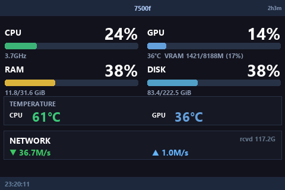

# Turing / TURZX 3.5" Dashboard for Windows 11

A Windows 11 port of [faridx82-sys/turing-turz-3.5inch](https://github.com/faridx82-sys/turing-turz-3.5inch) that runs as a **Windows service** and drives a Turing / TURZX 3.5" USB display (480×320) as a live system monitor.



## What it shows

| Area | Data |
| --- | --- |
| CPU | Load % and current frequency |
| GPU | Load %, VRAM usage, temperature (NVIDIA) |
| RAM | Used / total and load % |
| Disk | System drive usage |
| Temperature | CPU package and GPU temperature |
| Network | Download / upload throughput and total received |
| Header / footer | Hostname, uptime, clock |

The dashboard is rendered in landscape (480×320), sent over USB serial as RGB565, and refreshed every few seconds.

## Features

- **Runs as a service** — starts at boot, no user logged in required.
- **Auto-detects the display** by USB VID/PID and reconnects when it is unplugged.
- **No vendor app needed** — the panel is driven directly over the serial protocol.
- **CPU temperature** via LibreHardwareMonitor's sensor library, bundled in `lhm/` (no GUI or extra install needed).
- **GPU temperature / VRAM** via `nvidia-smi`.
- **Preview mode** renders a frame to PNG without touching the hardware.
- Log rotation and a standalone test-pattern tool for troubleshooting.

## Requirements

- Windows 10 or 11 (tested on Windows 11 x64)
- Python 3.10+ (64-bit) in `PATH`
- Turing / TURZX 3.5" USB display — `VID_1A86` / `PID_5722`, serial `USB35INCHIPSV2` (Rev A protocol)
- NVIDIA GPU and driver for the GPU row (optional; the rest works without it)
- Administrator rights for installation

## Quick start

```powershell
git clone https://github.com/faridx82-sys/turing-turz-3.5inch-windows.git
cd turing-turz-3.5inch-windows
```

Then, in an **elevated PowerShell**:

```powershell
.\setup.ps1
```

The script:

1. installs `pyserial`, `pillow` and `psutil`;
2. downloads [NSSM](https://nssm.cc/) (service wrapper) into the project folder;
3. uses the bundled [LibreHardwareMonitor](https://github.com/LibreHardwareMonitor/LibreHardwareMonitor) library in `lhm\` for CPU temperature (it re-downloads it only if the folder is missing);
4. stops the vendor `UsbMonitor` app and disables its scheduled task (if present);
5. registers and starts the `TuringDashboard` service as `LocalSystem`.

The panel should show the dashboard within a few seconds. Watch the log with:

```powershell
Get-Content "$env:ProgramData\TuringDashboard\monitor.log" -Tail 20 -Wait
```

## Manual installation

If you prefer to do it by hand:

```powershell
python -m pip install pyserial pillow psutil

# NSSM: https://nssm.cc/download  (use win64\nssm.exe)
# LibreHardwareMonitor: the required DLLs are already in .\lhm\

nssm install TuringDashboard "C:\Path\To\python.exe"
nssm set TuringDashboard AppParameters '"C:\Path\To\turing-dashboard\monitor_win.py"'
nssm set TuringDashboard AppDirectory "C:\Path\To\turing-dashboard"
nssm set TuringDashboard Start SERVICE_AUTO_START
nssm set TuringDashboard ObjectName LocalSystem
nssm set TuringDashboard AppStdout "$env:ProgramData\TuringDashboard\stdout.log"
nssm set TuringDashboard AppStderr "$env:ProgramData\TuringDashboard\stderr.log"
nssm start TuringDashboard
```

## Service management

```powershell
Get-Service TuringDashboard
Restart-Service TuringDashboard
Stop-Service TuringDashboard
```

Logs live in `C:\ProgramData\TuringDashboard\` (`monitor.log`, `stdout.log`, `stderr.log`).

## Preview without hardware

Render one frame to a PNG (no serial port is opened):

```powershell
python monitor_win.py --preview preview.png
```

This works without administrator rights; CPU temperature may show `--°C` because the sensor driver needs elevation.

## Configuration

Most settings are constants at the top of `monitor_win.py`:

- `BAUD_RATE` — serial speed (115200 for this panel)
- `DISPLAY_WIDTH` / `DISPLAY_HEIGHT` — native portrait size (320×480)
- `VID` / `PID` / `SERIAL_ID` — display auto-detection
- Brightness — `display.set_brightness(60)` in `main()` (0–100)
- Refresh interval — the `time.sleep(2)` in `DashboardRenderer.render()` is used to sample network throughput; the loop then sends a frame as fast as the panel accepts it
- Layout — `DashboardRenderer.render()` (`r = [38, 100, 162, 220]` sets the row positions)

After editing, restart the service.

## How temperatures work

- **GPU** — `nvidia-smi --query-gpu=utilization.gpu,memory.used,memory.total,temperature.gpu`.
- **CPU** — `lhm_cpu_temp.ps1` loads `lhm\LibreHardwareMonitorLib.dll`, opens the CPU sensor group and prints the `Tctl/Tdie` (AMD) or package (Intel) temperature. It runs as `SYSTEM` through the service, so the hardware driver can load. The value is cached for 30 seconds.
- If the sensor cannot be read, the panel shows `--°C` and a warning is written to the log once.

No LibreHardwareMonitor GUI or background app is required — only its library.

## Troubleshooting

### The panel stays black

1. **Flow control is mandatory.** The panel silently drops frames unless the serial port is opened with RTS/CTS hardware flow control (`rtscts=True`). The dashboard and `tools/display_test.py` both do this.
2. **Close the vendor app.** `UsbMonitor.exe` holds the COM port; stop it (and disable its scheduled task) before starting the service.
3. **Check the port.** The display should appear in Device Manager as `USB Serial Device (COMx)` with `VID_1A86&PID_5722`.
4. **Test the hardware directly:**

   ```powershell
   python tools\display_test.py
   ```

   A green screen with white `HELLO` text should appear.

### `Access is denied` / could not open COM port

Another process still owns the port — usually `UsbMonitor.exe` or a second copy of `monitor_win.py`. Stop them and retry.

### The service starts and immediately stops

Check `C:\ProgramData\TuringDashboard\stderr.log` and run the script manually to see the error:

```powershell
python monitor_win.py COM3
```

### CPU temperature shows `--°C`

- The service must run as `LocalSystem` (or another administrator account) so the sensor driver can load.
- Make sure the `lhm` folder exists next to `monitor_win.py`; re-run `setup.ps1` to download it.
- Some virtual machines expose no CPU temperature sensor at all.

### GPU row says "NVIDIA driver not found"

`nvidia-smi` is not in `PATH`. It normally lives in `C:\Windows\System32` (driver 470+) or `C:\Program Files\NVIDIA Corporation\NVSMI`.

### The image is shifted or has wrong colors

The clear command only works reliably in the panel's native **portrait** orientation. The dashboard clears in portrait and then switches to landscape before drawing, matching the reference library.

## Protocol notes

Useful if you want to adapt this to another panel:

- USB CDC serial, **115200 8N1, RTS/CTS enabled**.
- Commands are **6-byte packets**: 5 bytes of packed coordinates + 1 command byte.
- Commands used: `101` reset, `102` clear, `108` screen off, `109` screen on, `110` brightness, `121` orientation, `197` bitmap.
- Orientation is a 16-byte packet: `buf[5]=121`, `buf[6]=100+orientation`, `buf[7..10]=width,height` (big-endian).
- Bitmap data is **RGB565 little-endian**, rows top to bottom, sent in chunks of `width * 8` bytes.
- The official 3.5" panel does **not** answer the `HELLO` command (`0x45` × 6 or the newer `0xCA` packet), which is expected for Rev A hardware.
- Native resolution is 320×480 portrait; the dashboard renders 480×320 landscape.

## Reverting to the vendor app

```powershell
.\uninstall.ps1
```

This stops and removes the service and re-enables the vendor `UsbMonitor` scheduled task. Start the vendor app again if you want it to drive the panel.

## Project layout

```
monitor_win.py          Dashboard renderer, serial driver and service entry point
lhm_cpu_temp.ps1        Reads the CPU package temperature via LibreHardwareMonitor
setup.ps1               One-shot service installer
uninstall.ps1           Removes the service and re-enables the vendor app
tools/display_test.py   Standalone test pattern (hardware/protocol check)
preview.png             Rendered dashboard preview
lhm/                    Bundled LibreHardwareMonitor v0.9.6 library (MPL-2.0, see lhm/NOTICE.md)
nssm.exe                Service wrapper (downloaded, git-ignored)
```

## Credits

- Original Linux project: [faridx82-sys/turing-turz-3.5inch](https://github.com/faridx82-sys/turing-turz-3.5inch)
- Protocol reference: [mathoudebine/turing-smart-screen-python](https://github.com/mathoudebine/turing-smart-screen-python)
- [LibreHardwareMonitor](https://github.com/LibreHardwareMonitor/LibreHardwareMonitor) v0.9.6 for CPU sensors (bundled binaries, MPL-2.0)
- [NSSM](https://nssm.cc/) for service wrapping

Not affiliated with Turing or TURZX.

## License

GPL-3.0 — see [LICENSE](LICENSE).

The bundled binaries in `lhm/` are third-party components distributed under
their own licenses (LibreHardwareMonitor is MPL-2.0). See
[`lhm/NOTICE.md`](lhm/NOTICE.md) for details and source links.
